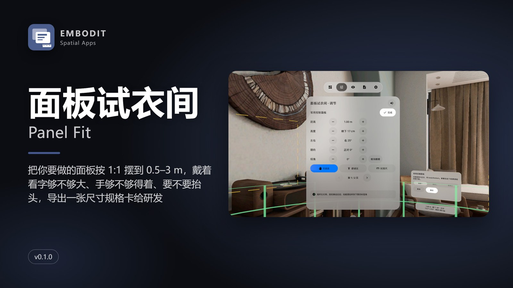
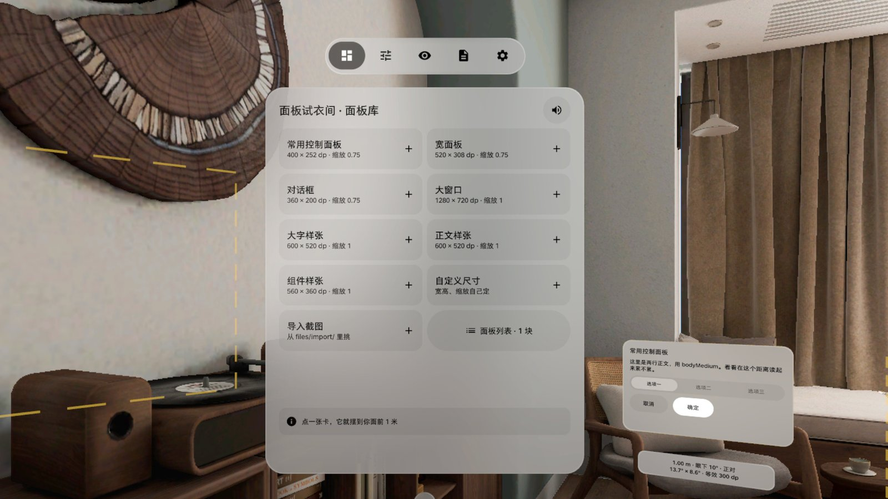
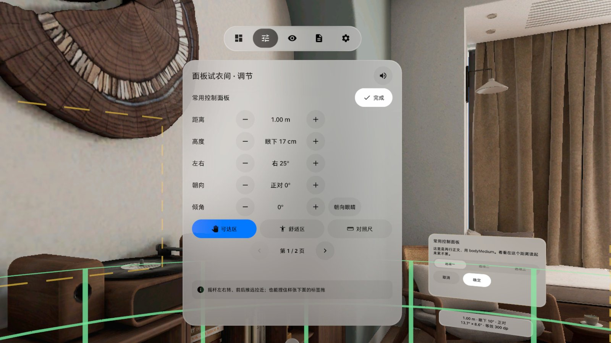
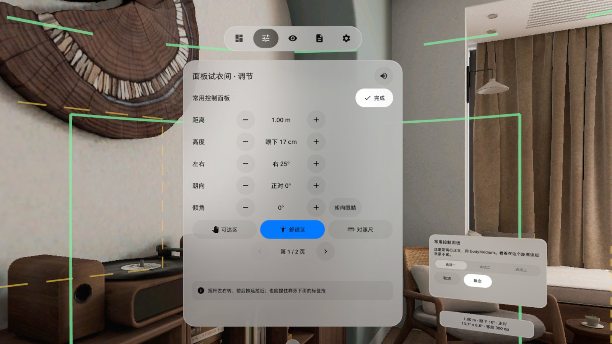
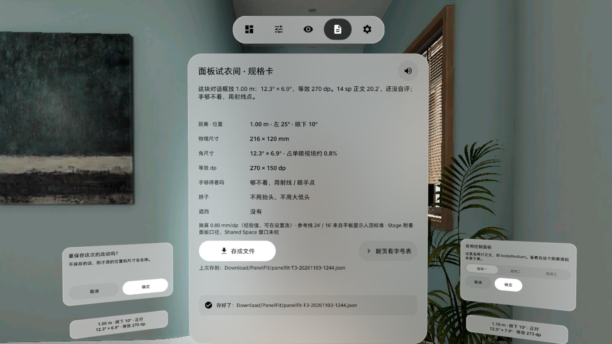

# 面板试衣间 Panel Fit

> **v0.1.0 · 预发布 · 模拟器 QA 第 2 轮没跑完，真机未验证**（Pre-release · emulator QA round 2 unfinished, not yet verified on a headset）



[中文](#中文) · [English](#english)

---

## 中文

做面板之前先「试穿」。PICO OS 6 空间应用：把你要做的面板按 1:1 摆在面前 0.5–3 米，戴着看字够不够大、手够不够得着、要不要抬头，最后存一张尺寸规格卡给研发。

- **面板库**：常用控制面板、宽面板、对话框、大窗口、大字样张、正文样张、组件样张、自定义尺寸，也能导入一张截图当样张；最多同时摆 6 块，都是真的 SpatialUI 面板
- **调节**：距离、高度、左右、朝向、倾角逐项步进，摇杆推远拉近；样张下面的尺寸标签实时显示距离、角尺寸和等效 dp
- **看得清吗**：打开可达区、舒适区（不用抬头 / 大转头的范围）和对照尺，一眼看出手够不够得着、脖子累不累、样张有没有互相挡
- **规格卡**：每块样张一张卡，写清距离 / 位置、物理尺寸、角尺寸、等效 dp、手够不够得着、脖子、遮挡；存成 JSON + Markdown 文件
- **设置 · 校准**：dp 换算系数、看得清 / 太小的字号线，按你自己的眼睛调
- 中英双语，不联网，不需要账号

### 截图（模拟器，中文界面）

| | |
|---|---|
|  面板库：选一种面板，它就摆到你面前 1 米 |  调节：距离、高度、左右、朝向、倾角逐项步进 |
|  可达区：绿线框出手够得着的范围 |  舒适区：不用抬头、不用大转头的范围 |
|  规格卡：物理尺寸、角尺寸、等效 dp、够不够得着 |  存成文件：规格卡写进 Download 目录 |

截图来自 PICO 模拟器（High Definition 2560），是 QA 第 1 轮拍的（v0.1.0 打回修复之前那一版，两处修复都不在这些画面里）；状态用调试广播定住拍摄。演示视频（Release 附件 `PanelFit-demo-1080p.mp4`）是模拟器上由调试输入驱动的演示，**非真实手势录像**，无声。

### 安装

```bash
adb install -r PanelFit-v0.1.0.apk
pico-cli app launch io.embodit.panelfit
```

APK 在 [Release v0.1.0](https://github.com/kejing-dev/PanelFitApp/releases/tag/v0.1.0)。需要 PICO OS 6（Spatial SDK 6.1.9，minSdk 35）。

### 发布状态

- **QA 第 1 轮**打回两条，已修，**待复测**：
  1. 英文设置页「Too small below」被 − 键截断——已修，还没复测。
  2. 真实捏住样张下面的尺寸标签拖不动（调试命令能拖）——已修；QA 第 2 轮在模拟器上真实捏住拖了 12 次都跟手、松手停住，但第 2 轮没跑完，没出正式结论。
- 其余 QA 第 1 轮通过：无 Material 组件、冷启动 60 秒无 ANR、中英全部状态截图、真实点按（试一块、步进、完成、选中、设置、退出）都通。
- **真机未验证**：真手捏住拖标签、实体摇杆、字看不看得清 / 伸手够不够得着 / 脖子累不累的实际感受、转身后冷启动的摆位、公共 Download 目录写入。

### 已知问题（不挡用）

1. 样张贴近或挡住工具窗口时只能变成 30% 透明，射线仍会打到样张（平台限制，已反馈）。
2. 把系统工具窗口拖走后，样张自动摆放不再避开它，两者可能前后叠。
3. 两块玻璃样张从眼位看前后叠着时，后面被挡的部分在模拟器上呈黑带；工具窗口冷启动偶尔下半截黑（平台问题，已反馈）。
4. 选中样张的黄框在截图里不明显（2 dp）。

### 开发

Kotlin · PICO Spatial SDK 6.1.9。结构、调试广播、截图清单见 [AGENTS.md](AGENTS.md)。字体和图标：SpatialUI / PicoTheme 自带字体，界面图标为 Material Icons（Apache-2.0）。

---

## English

Try a panel on before you build it. A PICO OS 6 spatial app: put the panels you plan to build in front of you at 1:1, 0.5–3 m away, and check with the headset on whether the text is big enough, whether you can reach it and whether you have to look up. Then save a spec card for the developers.

- **Panel library**: control panel, wide panel, dialog, large window, big type, body type, component specimen, custom size, or an imported screenshot; up to six at once, all real SpatialUI panels
- **Adjust**: step distance, height, left / right, facing and tilt, or push and pull with the stick; the size label under each specimen shows distance, angular size and equivalent dp live
- **Can you read it**: reach zone, comfort zone (no looking up, no big head turns) and a reference ruler show reach, neck strain and overlaps at a glance
- **Spec card**: one card per specimen with position, physical size, angular size, equivalent dp, reach, neck and overlap; saved as JSON + Markdown
- **Settings · calibration**: dp conversion factor and the legible / too-small type lines, tuned to your own eyes
- Chinese and English, offline, no account

### Screenshots

See the table above (Chinese UI on the PICO emulator, High Definition 2560). They were taken in QA round 1, before the rework build, and neither fix shows in them. The demo video in the release (`PanelFit-demo-1080p.mp4`) is driven by debug input on the emulator — **not a recording of real hand gestures** — and has no sound.

### Install

```bash
adb install -r PanelFit-v0.1.0.apk
pico-cli app launch io.embodit.panelfit
```

Get the APK from [Release v0.1.0](https://github.com/kejing-dev/PanelFitApp/releases/tag/v0.1.0). Requires PICO OS 6 (Spatial SDK 6.1.9, minSdk 35).

### Release status

- **QA round 1** sent back two issues; both are fixed and **awaiting retest**: (1) the English settings label "Too small below" was clipped by the − button — fixed, not retested; (2) a real pinch on the size label did not drag the specimen — fixed; in QA round 2 twelve real pinch drags on the emulator all followed the hand and stayed put on release, but round 2 was stopped before it finished.
- Everything else in round 1 passed: no Material components, 60 s cold start with no ANR, all states captured in Chinese and English, real taps (try one, steppers, done, select, settings, quit) all work.
- **Not yet verified on a headset**: real-hand label drag, the physical stick, how legible / reachable / comfortable it actually feels, placement after a cold start facing backwards, writing to the public Download folder.

### Known issues (non-blocking)

1. A specimen that comes too close or covers the tools window can only fade to 30%; the ray still hits it (platform limit, reported).
2. After you drag the system tools window away, automatic specimen placement no longer avoids it, so the two can overlap.
3. Two glass specimens overlapping from the eye point show a black band on the hidden part on the emulator; the tools window occasionally cold-starts with a black lower half (platform issue, reported).
4. The yellow selection frame is hard to see in screenshots (2 dp).

### Development

Kotlin · PICO Spatial SDK 6.1.9. See [AGENTS.md](AGENTS.md) for structure, debug broadcasts and the screenshot list. Fonts come with SpatialUI / PicoTheme; UI icons are Material Icons (Apache-2.0).
