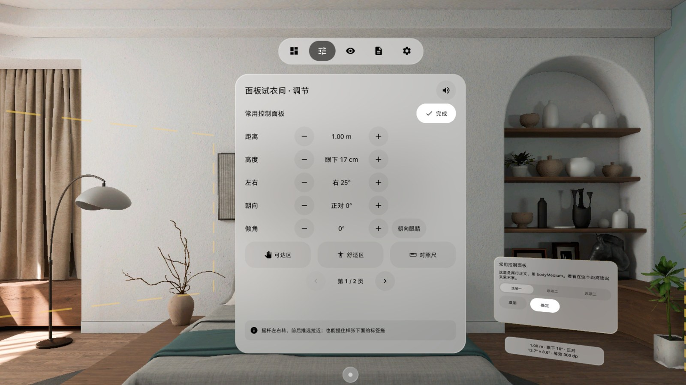
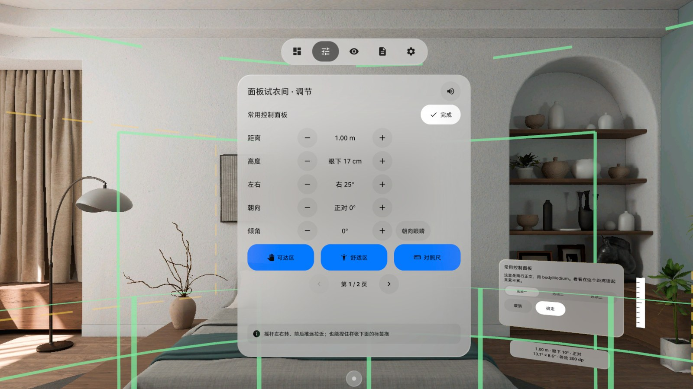
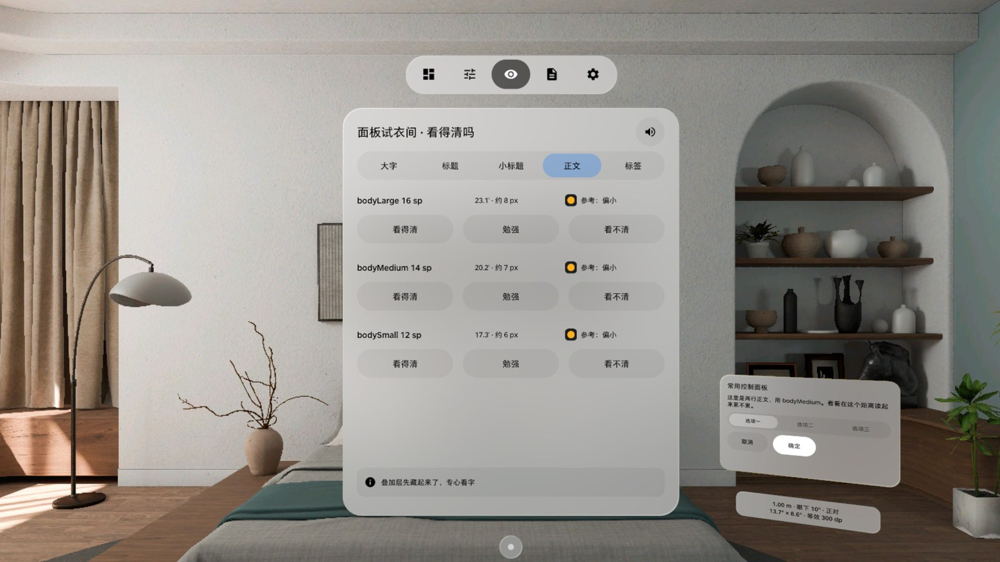
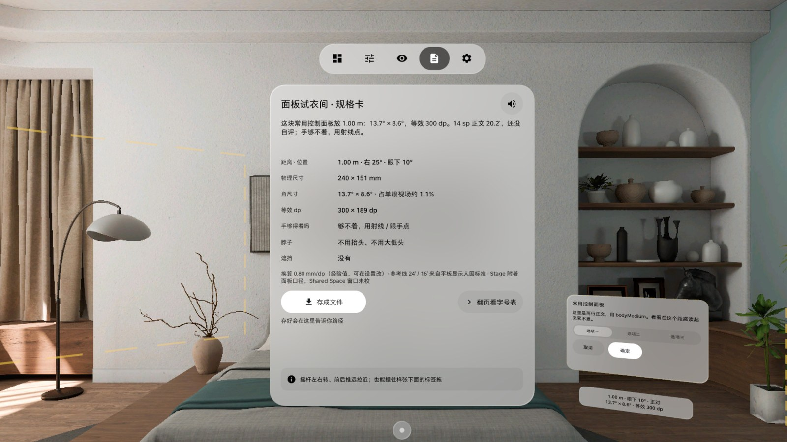
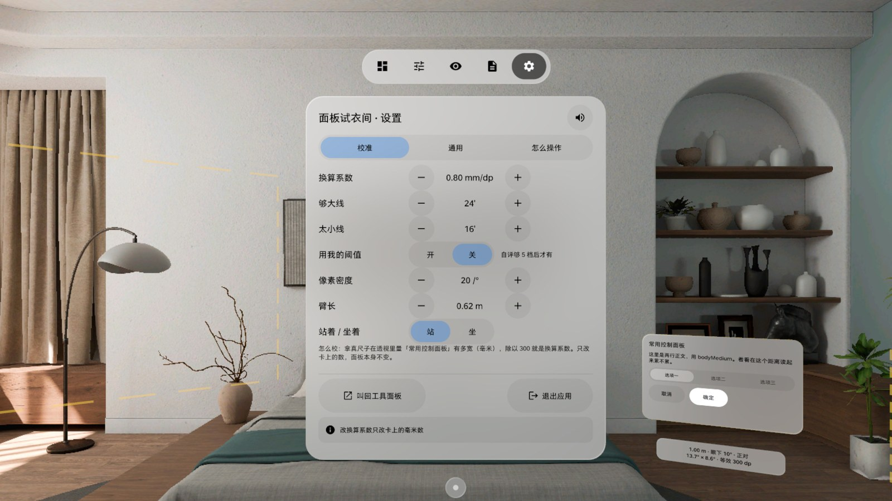

# 面板试衣间 Panel Fit

> **v0.1.1 · 正式版 · 已在头显上验过退出**（Release · quit verified on a headset）


[中文](#中文) · [English](#english)

---

## 中文

做面板之前先「试穿」。PICO OS 6 空间应用：把你要做的面板按 1:1 摆在面前 0.5–3 米，戴着看字够不够大、手够不够得着、要不要抬头，最后存一张尺寸规格卡给研发。

- **面板库**：常用控制面板、宽面板、对话框、大窗口、大字样张、正文样张、组件样张、自定义尺寸，也能导入一张截图当样张；最多同时摆 6 块，都是真的 SpatialUI 面板
- **调节**：距离、高度、左右、朝向、倾角逐项步进，摇杆推远拉近；样张下面的尺寸标签实时显示距离、角尺寸和等效 dp
- **看得清吗**：打开可达区、舒适区（不用抬头 / 大转头的范围）和对照尺，一眼看出手够不够得着、脖子累不累、样张有没有互相挡
- **规格卡**：每块样张一张卡，写清距离 / 位置、物理尺寸、角尺寸、等效 dp、手够不够得着、脖子、遮挡；存成 JSON + Markdown 文件
- **设置**：校准 dp 换算系数和看得清 / 太小的字号线；[叫回工具面板] 和 [退出应用] 一打开设置就在底部
- 中英双语，不联网，不需要账号

### v0.1.1 改了什么

- 设置里加了 **[退出应用]**，和 [叫回工具面板] 一起放在设置底部，校准 / 通用 / 怎么操作三个分段都看得到；点了先在原地确认，确认后应用真正退出，最近任务里不留
- 设置新增「怎么操作」分段，说明跟着应用语言走
- 打开窗口前先等你平视（低头 / 仰头时提示「平视前方，面板就出来」），不会把面板摆到脚下或头顶
- 卡片、评分键、叠加层开关间距放大到 16 dp，开关加大到 64 dp；工具面板内容高度加大
- 修了 v0.1.0 QA 打回的两条：英文设置页「Too small below」被截断；真实捏住尺寸标签拖不动

### 截图（模拟器，中文界面）

| | |
|---|---|
|  面板库：选一种面板，它就摆到你面前 1 米 |  调节：距离、高度、左右、朝向、倾角逐项步进 |
|  可达区、舒适区、对照尺一起打开 |  看得清吗：逐级字号自评 |
|  规格卡：物理尺寸、角尺寸、等效 dp、够不够得着 |  设置：底部就是 [叫回工具面板] 和 [退出应用] |

截图是 v0.1.1 在 PICO 模拟器（High Definition 2560）上拍的，状态用调试广播定住。演示视频是模拟器上由调试输入驱动的演示，**非真实手势录像**，无声。

### 安装

```bash
adb install -r PanelFit-v0.1.1.apk
pico-cli app launch io.embodit.panelfit
```

APK 在 [Release v0.1.1](https://github.com/kejing-dev/PanelFitApp/releases/tag/v0.1.1)（assembleRelease 未签名包，上架平台重签名；自己装要先用自己的 key 签名）。需要 PICO OS 6（Spatial SDK 6.1.9，minSdk 35）。旧版见 [Release v0.1.0](https://github.com/kejing-dev/PanelFitApp/releases/tag/v0.1.0)。

### 验证情况

- **头显**：v0.1.1 已装到 PICO 头显，设置首屏看得到 [退出应用]，真实点退出后进程结束、最近任务里没有残留；用户已放行发布。
- **模拟器**：界面门禁 PASS；设置首屏（校准分段，不切分段）底部看得到 [退出应用]；退出后最近任务里没有残留，无崩溃；LevelGate 单测 7/7、领域单测 35/35。
- **没跑**：v0.1.1 的正式 QA 轮（用户叫停，直接发布），所以英文截断、标签拖动两条修复没有 QA 的正式复测结论（研发站自测过、QA 第 2 轮真实拖动 12/12 跟手）。

### 已知问题（不挡用）

1. 样张贴近或挡住工具窗口时只能变成 30% 透明，射线仍会打到样张（平台限制，已反馈）。
2. 把系统工具窗口拖走后，样张自动摆放不再避开它，两者可能前后叠。
3. 两块玻璃样张从眼位看前后叠着时，后面被挡的部分在模拟器上呈黑带（平台问题，已反馈）。
4. 选中样张的黄框在截图里不明显（2 dp）。

### 开发

Kotlin · PICO Spatial SDK 6.1.9。结构、调试广播、截图清单见 [AGENTS.md](AGENTS.md)。字体和图标：SpatialUI / PicoTheme 自带字体，界面图标为 Material Icons（Apache-2.0）。

---

## English

Try a panel on before you build it. A PICO OS 6 spatial app: put the panels you plan to build in front of you at 1:1, 0.5–3 m away, and check with the headset on whether the text is big enough, whether you can reach it and whether you have to look up. Then save a spec card for the developers.

- **Panel library**: control panel, wide panel, dialog, large window, big type, body type, component specimen, custom size, or an imported screenshot; up to six at once, all real SpatialUI panels
- **Adjust**: step distance, height, left / right, facing and tilt, or push and pull with the stick; the size label under each specimen shows distance, angular size and equivalent dp live
- **Can you read it**: reach zone, comfort zone (no looking up, no big head turns) and a reference ruler show reach, neck strain and overlaps at a glance
- **Spec card**: one card per specimen with position, physical size, angular size, equivalent dp, reach, neck and overlap; saved as JSON + Markdown
- **Settings**: calibrate the dp factor and the legible / too-small type lines; [Recall tools panel] and [Quit app] sit at the bottom as soon as settings open
- Chinese and English, offline, no account

### What's new in v0.1.1

- **[Quit app]** in settings, next to [Recall tools panel] at the bottom of every settings segment (Calibrate / General / How to). It confirms in place, then really quits; nothing is left in Recents
- New "How to" settings segment, in the app's own language
- Windows wait until you look level before they open ("Look straight ahead and the panel appears"), so panels never land at your feet or overhead
- 16 dp gaps between cards, rating keys and overlay toggles; toggles grown to 64 dp; taller tools panel
- Both v0.1.0 QA findings fixed: "Too small below" clipped in English settings; a real pinch on the size label did not drag

### Screenshots

See the table above (v0.1.1, Chinese UI on the PICO emulator, High Definition 2560; states set with debug broadcasts). The demo video is driven by debug input on the emulator — **not a recording of real hand gestures** — and has no sound.

### Install

```bash
adb install -r PanelFit-v0.1.1.apk
pico-cli app launch io.embodit.panelfit
```

Get the APK from [Release v0.1.1](https://github.com/kejing-dev/PanelFitApp/releases/tag/v0.1.1) (unsigned assembleRelease build; the store re-signs it — sign it with your own key to sideload). Requires PICO OS 6 (Spatial SDK 6.1.9, minSdk 35). Older: [Release v0.1.0](https://github.com/kejing-dev/PanelFitApp/releases/tag/v0.1.0).

### Verification

- **Headset**: v0.1.1 installed on a PICO headset; [Quit app] is on the first settings screen, and a real tap on quit ends the process with nothing left in Recents. Release approved by the owner.
- **Emulator**: UI gates PASS; [Quit app] visible on the first settings screen without switching segments; no Recents entry and no crash after quitting; unit tests LevelGate 7/7, domain 35/35.
- **Not run**: a formal QA round for v0.1.1 (skipped at the owner's request), so the two v0.1.0 fixes have no formal QA retest (self-tested in build; QA round 2 saw 12/12 real pinch drags follow the hand).

### Known issues (non-blocking)

1. A specimen that comes too close or covers the tools window can only fade to 30%; the ray still hits it (platform limit, reported).
2. After you drag the system tools window away, automatic specimen placement no longer avoids it, so the two can overlap.
3. Two glass specimens overlapping from the eye point show a black band on the hidden part on the emulator (platform issue, reported).
4. The yellow selection frame is hard to see in screenshots (2 dp).

### Development

Kotlin · PICO Spatial SDK 6.1.9. See [AGENTS.md](AGENTS.md) for structure, debug broadcasts and the screenshot list. Fonts come with SpatialUI / PicoTheme; UI icons are Material Icons (Apache-2.0).
